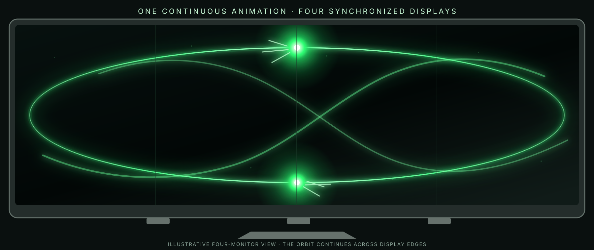

# Swordfish Screensaver

**An original, cross-platform procedural plasma screensaver for multi-monitor desktops.**

Swordfish draws one continuous animated orbit across the entire virtual desktop. The beam, comet orbs, trails, and glow stay synchronized as they cross monitor boundaries. It is designed to look like one large animation spanning a wall of displays—not four separate animations.



<sub>Illustrative four-monitor view. The orbit is one continuous path across all four displays; the exact monitor arrangement and animation appearance depend on your desktop layout and settings.</sub>

## Features

- **Synchronized multi-monitor output:** one shared animation timeline across all connected displays, including wide four-monitor layouts.
- **Plasma orbit:** circle, oval, wide oval, and tall oval shapes.
- **Moving plasma orbs:** configure 1–8 orbs, their brightness, glow, and the length of their comet trails.
- **Meteor flames:** adjustable flame intensity behind moving orbs.
- **Travel direction:** clockwise, counterclockwise, or random direction (alternates direction every three cycles).
- **Color themes:** Classic, Lime, Emerald, Teal, Ice Blue, Amber, Violet, White, and Fireball (red/orange).
- **Fade/blackout timing:** configure the blank interval between animation appearances.
- **Optional date and clock:** available in the KDE Plasma 6 Screen Locking integration.
- **Portable renderer:** SDL2 and OpenGL application with CMake build support.

## Platform and package status

GitHub Actions builds and tests the platforms below. A passing CI job confirms that the code compiled and its automated tests/smoke checks passed in that runner; it does not replace testing on a physical desktop with its GPU, display server, and screen locker.

| Platform | CI output | Installation format |
|---|---|---|
| Ubuntu 22.04, 24.04, 26.04 (x86_64) | Native package | `.deb` |
| Debian 12, 13 (x86_64) | Native package | `.deb` |
| Kali Rolling (amd64) | Native package | `.deb` |
| AlmaLinux 10 (x86_64) | Native package | `.rpm` |
| Rocky Linux 10 (x86_64) | Native package | `.rpm` |
| Oracle Linux 10 (x86_64) | Native package | `.rpm` |
| CentOS Stream 10 (x86_64) | Native package | `.rpm` |
| Fedora 43, 44 (x86_64) | Tested executable archive | `.tar.gz` |
| Arch Linux (x86_64) | Tested executable archive | `.tar.gz` |
| FreeBSD 14.3, 15.0 (x86_64) | Tested executable archive | `.tar.gz` |
| macOS 26 Intel and Apple Silicon | Application bundle | `.zip` containing `.app` |
| Windows x64 | Standalone executable | `.zip` |
| Generic Ubuntu 24.04 Linux runner | Standalone executable | GitHub Actions artifact |

**Important distinctions**

- Ubuntu, Debian, Kali, and Enterprise Linux 10 produce installable package-manager packages.
- Fedora, Arch Linux, and FreeBSD currently receive tested executable archives, not native RPM, Pacman, or FreeBSD `pkg` packages.
- The macOS download is an SDL application bundle, not a native `.saver` module or System Settings screen-saver extension.
- The Windows download is a standalone `.exe`, not a native Windows `.scr` screensaver or installer.
- The KDE Plasma 6 Screen Locking background integration is included in the EL10 RPM builds. Other platform builds currently provide the portable SDL2/OpenGL application.
- Oracle Solaris 11.4 has a build script and an optional manual workflow for a self-hosted runner. It is **not currently a CI-verified package or binary**.

## Download builds

### Published releases

When a version is released, download the asset matching your operating system from:

**[Swordfish Screensaver — GitHub Releases](https://github.com/azwieg103/swordfish-screensaver/releases)**

The release workflow runs when a `v*` tag is pushed and publishes assets only after all required platform jobs succeed. If no release is published yet, use the Actions artifacts below.

### CI artifacts

1. Open [GitHub Actions — Build](https://github.com/azwieg103/swordfish-screensaver/actions/workflows/build.yml).
2. Select a successful **Build** workflow run.
3. Scroll to **Artifacts** at the bottom of the run summary.
4. Download the artifact for your operating system. GitHub downloads each artifact as a ZIP file; extract that ZIP first.
5. Follow the matching installation instructions below.

Artifact names:

| OS | Artifact name |
|---|---|
| Ubuntu 22.04 | `swordfish-Ubuntu-22.04-deb` |
| Ubuntu 24.04 | `swordfish-Ubuntu-24.04-deb` |
| Ubuntu 26.04 | `swordfish-Ubuntu-26.04-deb` |
| Debian 12 | `swordfish-Debian-12-deb` |
| Debian 13 | `swordfish-Debian-13-deb` |
| Kali Rolling | `swordfish-kali-rolling-deb` |
| AlmaLinux 10 | `swordfish-rpm-AlmaLinux-10` |
| Rocky Linux 10 | `swordfish-rpm-Rocky-10` |
| Oracle Linux 10 | `swordfish-rpm-OracleLinux-10` |
| CentOS Stream 10 | `swordfish-rpm-CentOS-Stream-10` |
| Fedora 43 / 44 | `swordfish-fedora-43` / `swordfish-fedora-44` |
| Arch Linux | `swordfish-archlinux` |
| FreeBSD 14.3 / 15.0 | `swordfish-freebsd-14.3-amd64` / `swordfish-freebsd-15.0-amd64` |
| macOS Apple Silicon / Intel | `swordfish-macos-arm64` / `swordfish-macos-x86_64` |
| Windows x64 | `swordfish-windows-x64` |
| Generic Linux | `swordfish-linux` |

## Install prebuilt packages

The commands below assume you have downloaded the matching GitHub Actions artifact ZIP and extracted it. Replace paths or filenames with the actual extracted filename if needed.

### Ubuntu 22.04 / 24.04 / 26.04

The artifact contains an amd64 `.deb` package:

```bash
sudo apt update
sudo apt install ./swordfish-Ubuntu-22.04-amd64.deb   # or 24.04 / 26.04
```

If you install with `dpkg -i` instead, resolve any missing dependencies with:

```bash
sudo apt-get install -f
```

### Debian 12 / 13

The artifact contains an amd64 `.deb` package:

```bash
sudo apt update
sudo apt install ./swordfish-Debian-12-amd64.deb      # or Debian 13
```

### Kali Rolling

The artifact contains an amd64 `.deb` package:

```bash
sudo apt update
sudo apt install ./swordfish-kali-rolling-amd64.deb
```

### AlmaLinux 10 / Rocky Linux 10 / Oracle Linux 10 / CentOS Stream 10

Download the RPM artifact for your distribution, extract the artifact ZIP, then install the RPM with DNF:

```bash
sudo dnf install ./swordfish-screensaver-*.rpm
```

The EL10 RPM includes the KDE Plasma 6 Screen Locking integration. On KDE Plasma 6, open **System Settings → Screen Locking**, choose **Swordfish Plasma** as the background, and adjust its settings. Keep Plasma's normal screen locking and password authentication enabled: Swordfish supplies the animated background, not the security mechanism.

If the new background does not appear immediately, restart Plasma Shell or log out and back in:

```bash
kquitapp6 plasmashell 2>/dev/null || true
plasmashell --replace
```

### Fedora 43 / 44

The Fedora artifact is a compressed archive containing the executable, not an RPM. Install its runtime libraries, extract the artifact ZIP and then the `.tar.gz` file:

```bash
sudo dnf install -y SDL2 mesa-libGL libX11 libXext libXrandr libXrender libXfixes libXi libXcursor libXinerama
tar -xzf swordfish-fedora-<version>-x86_64.tar.gz
sudo install -Dm755 swordfish-screensaver /usr/local/bin/swordfish-screensaver
```

### Arch Linux

The Arch artifact is a compressed executable archive, not a Pacman package:

```bash
sudo pacman -S --needed sdl2 mesa libx11 libxext libxrandr libxrender libxfixes libxi libxcursor libxinerama
tar -xzf swordfish-archlinux-x86_64.tar.gz
sudo install -Dm755 swordfish-screensaver /usr/local/bin/swordfish-screensaver
```

### FreeBSD 14.3 / 15.0

Download the archive matching your FreeBSD release and architecture. Install the runtime libraries, then extract the archive at the filesystem root; it contains the `usr/local/bin` installation path:

```sh
sudo pkg install sdl2 mesa-libs
sudo tar -xzf swordfish-freebsd-14.3-amd64.tar.gz -C /  # or FreeBSD 15.0
```

### macOS 26 — Apple Silicon and Intel

Download the ZIP matching your Mac:

- Apple Silicon: `swordfish-macos-arm64`
- Intel: `swordfish-macos-x86_64`

Extract the ZIP and move **Swordfish Screensaver.app** into Applications. Open it from Applications or Finder. The app bundle uses a statically built SDL2 library.

The CI app bundle is not currently code-signed or notarized, and it is not a native macOS Screen Saver module. macOS may show a security warning when opening an unsigned app; review the publisher and source before choosing whether to allow it in **System Settings → Privacy & Security**.

### Windows x64

Download and extract `swordfish-windows-x64`. Run `swordfish-screensaver.exe`. The executable is built with static SDL2 and does not need a separate SDL2 runtime DLL.

This is currently a standalone application, not a native Windows `.scr` screensaver. Windows preview, timeout, and personalization integration are not implemented yet.

### Generic Linux executable

The `swordfish-linux` artifact is a standalone executable built on Ubuntu 24.04. Install SDL2 and OpenGL/X11 runtime libraries using your distribution's package manager, extract the GitHub artifact ZIP, then:

```bash
chmod +x swordfish-screensaver
sudo install -Dm755 swordfish-screensaver /usr/local/bin/swordfish-screensaver
```

Because this binary is linked against the libraries on the Ubuntu 24.04 build runner, it may not run on older or incompatible distributions. For other distributions, the recommended approach is to compile from source using the instructions below.

## Run the application

Run a windowed preview:

```bash
swordfish-screensaver --windowed
```

Run fullscreen across all connected displays:

```bash
swordfish-screensaver
```

Select one display (display numbers are zero-based):

```bash
swordfish-screensaver --monitor 0
```

Press **Esc** or **Q** to quit. Press **F** to toggle fullscreen.

## KDE Plasma 6 Screen Locking

The EL10 RPM builds include the **Swordfish Plasma** package for the Plasma 6 Screen Locking background chooser. It is intended for **System Settings → Screen Locking**, not for configuring the desktop wallpaper.

The Plasma renderer uses a shared native animation clock so separate display instances stay phase-synchronized. The same orbit can therefore continue across monitor boundaries, including four-display arrangements. Keep the desktop's normal lock screen and authentication enabled.

Available settings:

| Setting | Available values |
|---|---|
| Show time / show date | On or off |
| Clock format | 24-hour or 12-hour |
| Color theme | Classic, Lime, Emerald, Teal, Ice Blue, Amber, Violet, White, Fireball (red/orange) |
| Animation speed | 0.1×–3.0× |
| Orbit shape | Oval, Circle, Wide oval, Tall oval |
| Travel direction | Random (alternate every three cycles), Clockwise, Counterclockwise |
| Number of orbs | 1–8 |
| Meteor flame intensity | 0–200% |
| Glow intensity | 10–100% |
| Orb brightness | 10–200% |
| Orbit size | 50–120% |
| Trail length | 5–100% |
| Blackout duration | 0–60 seconds |
| Beam width | 5–60 |

The settings are stored by Plasma for the lock-screen background. Other platform builds do not currently include this Plasma-specific configuration UI.\n\nTo compile and install the Plasma integration from source on a system with the Plasma 6 development SDK installed, leave the option enabled (or set it explicitly):\n\n```bash\ncmake -S . -B build-plasma -DCMAKE_BUILD_TYPE=Release -DBUILD_TESTING=ON -DSWORDFISH_BUILD_PLASMA6=ON\ncmake --build build-plasma --parallel\nsudo cmake --install build-plasma\n```

## Optional idle launcher on Linux

The optional `swordfish-idle` launcher can start the SDL application after a period of inactivity and close it when keyboard or mouse activity resumes. It is not a replacement for the desktop's secure screen locker.

Current idle backends:

- **GNOME:** uses the GNOME Mutter session idle monitor through D-Bus.
- **X11:** uses `xprintidle` when installed.
- **KDE Wayland:** not currently supported by this launcher.

On an X11 session, install `xprintidle` using your distribution's package manager. Enable the per-user autostart entry:

```bash
mkdir -p ~/.config/autostart
cp /usr/share/applications/swordfish-idle.desktop ~/.config/autostart/
```

The configuration file is `~/.config/swordfish-screensaver.conf`. For example:

```ini
IDLE_TIMEOUT_MS=300000
GREEN=emerald
ORBS=1
BEAM_WIDTH=14
```

The default idle delay is five minutes. Set `IDLE_TIMEOUT_MS=600000` for ten minutes. Remove `~/.config/autostart/swordfish-idle.desktop` to disable autostart. Keep the desktop's own screen locking enabled and configure it to lock securely.

## Compile from source

### Requirements

- CMake 3.20 or newer
- A C++17 compiler (GCC, Clang, or MSVC)
- Git
- OpenGL development libraries
- SDL2 development libraries, or internet access so CMake can fetch the pinned SDL2 2.30.11 source
- X11 development libraries on Linux/Unix desktops where the platform requires them

The default build prefers a system SDL2 installation. If it cannot find SDL2, CMake fetches and builds the pinned SDL2 2.30.11 source; the first configure therefore needs network access. To force a reproducible static SDL2 build, set `-DSWORDFISH_FETCH_SDL2=ON`.

For portable builds that do not need the KDE-specific plugin, explicitly set `-DSWORDFISH_BUILD_PLASMA6=OFF`.

### Linux — Debian / Ubuntu / Kali

Install the development dependencies:

```bash
sudo apt update
sudo apt install -y build-essential cmake git libsdl2-dev libgl-dev \
  libx11-dev libxext-dev libxrandr-dev libxrender-dev libxfixes-dev \
  libxi-dev libxcursor-dev libxinerama-dev
```

### Linux — Fedora

```bash
sudo dnf install -y cmake gcc-c++ git make SDL2-devel mesa-libGL-devel \
  libX11-devel libXext-devel libXrandr-devel libXrender-devel \
  libXfixes-devel libXi-devel libXcursor-devel libXinerama-devel
```

### Linux — AlmaLinux / Rocky / Oracle Linux / CentOS Stream

For the portable SDL application, install the compiler and graphics dependencies:

```bash
sudo dnf install -y cmake gcc-c++ git make SDL2-devel mesa-libGL-devel \
  libX11-devel libXext-devel libXrandr-devel libXrender-devel \
  libXfixes-devel libXi-devel libXcursor-devel libXinerama-devel
```

If you are compiling on an EL10 system and need to build the Plasma 6 Screen Locking integration too, enable the distribution's EPEL and CRB/CodeReady Builder repositories and install the Plasma/Qt development SDK packages:

```bash
sudo dnf install -y dnf-plugins-core
sudo dnf install -y epel-release || sudo dnf install -y oracle-epel-release-el10
sudo dnf config-manager --set-enabled crb || sudo dnf config-manager --set-enabled ol10_codeready_builder
sudo dnf install -y extra-cmake-modules libplasma-devel kf6-kcoreaddons-devel \
  qt6-qtbase-devel qt6-qtdeclarative-devel qt6-qtshadertools-devel
```

The automated EL10 RPM builds use this Plasma SDK. The non-EL Linux builds currently compile the portable renderer only.

### Arch Linux

```bash
sudo pacman -S --needed base-devel cmake git sdl2 mesa libx11 libxext \
  libxrandr libxrender libxfixes libxi libxcursor libxinerama
```

### FreeBSD 14 / 15

```sh
sudo pkg install cmake ninja git pkgconf sdl2 mesa-libs
```

### macOS

Install Xcode Command Line Tools and Homebrew, then:

```bash
xcode-select --install
brew install cmake ninja
```

### Windows

Install Visual Studio 2022 or newer with the C++ desktop workload, CMake, Git, and vcpkg. From a Developer PowerShell with vcpkg available:

```powershell
vcpkg install sdl2:x64-windows-static
cmake -S . -B build -DCMAKE_TOOLCHAIN_FILE="$env:VCPKG_INSTALLATION_ROOT/scripts/buildsystems/vcpkg.cmake" -DVCPKG_TARGET_TRIPLET=x64-windows-static
cmake --build build --config Release
ctest --test-dir build -C Release --output-on-failure
```

### Build and test (Linux, FreeBSD, macOS, and other CMake platforms)

Clone the repository, configure, build, run the tests, and launch a preview:

```bash
git clone https://github.com/azwieg103/swordfish-screensaver.git
cd swordfish-screensaver
cmake -S . -B build -DCMAKE_BUILD_TYPE=Release -DBUILD_TESTING=ON -DSWORDFISH_BUILD_PLASMA6=OFF
cmake --build build --parallel
ctest --test-dir build --output-on-failure
./build/swordfish-screensaver --windowed
```

To build with the pinned static SDL2 source instead of a system SDL2 package:

```bash
cmake -S . -B build-static -DCMAKE_BUILD_TYPE=Release -DBUILD_TESTING=ON -DSWORDFISH_BUILD_PLASMA6=OFF -DSWORDFISH_FETCH_SDL2=ON
cmake --build build-static --parallel
ctest --test-dir build-static --output-on-failure
```

To install a locally compiled portable binary on Linux:

```bash
sudo cmake --install build
```

On macOS, select the architecture when configuring if you need a specific target:

```bash
cmake -S . -B build -DCMAKE_BUILD_TYPE=Release -DCMAKE_OSX_ARCHITECTURES=arm64 -DSWORDFISH_FETCH_SDL2=ON -DSWORDFISH_BUILD_PLASMA6=OFF
cmake --build build --parallel
ctest --test-dir build --output-on-failure
```

Use `x86_64` instead of `arm64` for an Intel Mac.

### Build an RPM locally on AlmaLinux 10

The RPM spec also builds and installs the Plasma 6 Screen Locking integration. Install the RPM build tools and the spec's build dependencies:

```bash
sudo dnf install -y rpm-build rpmdevtools dnf-plugins-core
sudo dnf builddep -y packaging/swordfish-screensaver.spec
```

From the repository root, create the source tarball and build the RPM:

```bash
mkdir -p ~/rpmbuild/{BUILD,BUILDROOT,RPMS,SOURCES,SPECS,SRPMS}
git archive --format=tar.gz --prefix=swordfish-screensaver-0.2.1/ HEAD \
  > ~/rpmbuild/SOURCES/swordfish-screensaver-0.2.1.tar.gz
cp packaging/swordfish-screensaver.spec ~/rpmbuild/SPECS/
rpmbuild -ba ~/rpmbuild/SPECS/swordfish-screensaver.spec
```

The resulting RPM is under `~/rpmbuild/RPMS/x86_64/`. See [packaging/README.md](packaging/README.md) for the RPM-specific notes.

### Oracle Solaris 11.4

Solaris has a dedicated build script, but has not yet been verified on a physical Solaris system or in a CI runner. Install a C++17 compiler (GCC recommended), CMake 3.20+, SDL2/OpenGL, and X11 development headers from the package sources available for your Solaris installation. Then run:

```sh
sh scripts/build-solaris11.sh
```

The script configures, compiles, runs the tests and CLI smoke test, and writes a compressed archive under `dist/`. The script checks that it is running on Solaris 11 (kernel release 5.11). A GitHub Actions Solaris build additionally requires a self-hosted runner labelled `self-hosted`, `solaris`, and `11`, plus the repository variable `SOLARIS11_RUNNER_ENABLED=true`.

## Command-line options

| Option | Description |
|---|---|
| `--windowed` | Open a resizable preview window |
| `--monitor N` | Use one display (zero-based index) instead of all displays |
| `--green classic\|lime\|emerald\|teal` | Select a renderer palette where supported by the CLI |
| `--orbs 1-8` | Set the number of orbiting plasma orbs |
| `--beam-width 5-60` | Set the beam width |
| `--help` | Show command-line help |

The richer set of color themes and visual controls is currently exposed through the KDE Plasma 6 Screen Locking settings UI in the EL10 RPM.

## Project structure

- `src/` — SDL2/OpenGL application and animation engine
- `tests/` — animation-engine tests
- `packaging/plasma6/` — KDE Plasma 6 Screen Locking package, QML UI, and geometry plugin
- `packaging/swordfish-screensaver.spec` — Enterprise Linux RPM spec
- `scripts/` — idle launcher and Solaris build script
- `.github/workflows/build.yml` — cross-platform build and packaging matrix
- `assets/` — project artwork

## Known limitations

- CI compilation and smoke tests do not guarantee identical rendering on every GPU, driver, compositor, or monitor arrangement. Physical-device testing is still needed.
- KDE Plasma 6 Screen Locking integration is currently packaged in the EL10 RPM pipeline; other distribution builds do not currently ship it.
- The optional idle launcher supports GNOME's Mutter idle monitor and X11 via `xprintidle`; it does not yet support KDE Wayland.
- macOS does not yet have a native `.saver` module or System Settings integration.
- Windows does not yet have a native `.scr` screensaver, preview, or configuration panel.
- Fedora, Arch Linux, and FreeBSD artifacts are executable archives, not native distribution packages.
- Solaris 11.4 has a build script, but its build and runtime remain unverified.

## License and attribution

- Application source code: **GNU GPL-3.0-or-later**. See [LICENSE](LICENSE).
- Four-monitor overview artwork: original repository illustration, **CC0 1.0**. See [assets/four-monitor-output.svg](assets/four-monitor-output.svg).
- The animation is procedurally generated. Do not add copyrighted film footage, screenshots, music, extracted frames, logos, or code from unrelated screensavers without confirming permission and documenting the applicable license.
- “Swordfish” is used as an independent project name. This project is not affiliated with, endorsed by, or sponsored by any film studio or other rights holder.

## Contributing

Bug reports and pull requests are welcome. Include:

- Operating system and version
- CPU and GPU model
- Graphics driver and desktop environment
- Display count, resolution, arrangement, and refresh rates
- Whether you are using Wayland or X11
- Build/test logs and steps to reproduce the issue
