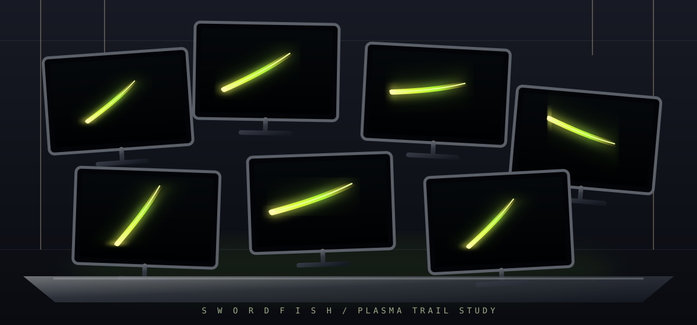

# Swordfish Screensaver

An independent, cross-platform animated plasma screensaver concept for Linux and Windows.

The animation is an original procedural plasma beam orbiting one large circle across the virtual desktop. Each monitor displays only the portion of that shared animation that falls within its screen bounds, keeping the effect continuous across monitor edges. The beam alternates between clockwise and counter-clockwise motion and periodically splits into two or four synchronized pulses before merging back into one.



The concept artwork above was created specifically for this repository and is dedicated to the public domain under [CC0 1.0](https://creativecommons.org/publicdomain/zero/1.0/).

## Current status

**0.2.1 development build.** The standalone application supports synchronized multi-monitor rendering and configurable green palettes. Linux adds an optional idle launcher for KDE/X11 and GNOME sessions; the desktop's own screen locker remains responsible for password-protected locking. The animation now supports thicker rays, larger plasma orbs, and configurable multiple orbiting orbs.

## Download releases

Published binaries will be attached to the repository's [GitHub Releases](https://github.com/azwieg103/swordfish-screensaver/releases). Each tagged release is intended to include an AlmaLinux 10 RPM and a Windows x64 ZIP. Until a release is published, use the source build instructions below.

## Build on AlmaLinux 10

Install the compiler, CMake, OpenGL and X11 development files:

```bash
sudo dnf install -y cmake gcc-c++ git make mesa-libGL-devel \
  libX11-devel libXext-devel libXrandr-devel libXrender-devel \
  libXfixes-devel libXi-devel libXcursor-devel libXinerama-devel
```

SDL2 is used from the system if available. Otherwise CMake downloads and builds pinned SDL2 release `2.30.11`; the first configure therefore needs internet access.

```bash
cmake -S . -B build -DCMAKE_BUILD_TYPE=Release
cmake --build build --parallel
./build/swordfish-screensaver --windowed
```

Run fullscreen by omitting `--windowed`; fullscreen uses all connected monitors. Use `--monitor 1` to limit fullscreen to one zero-based display. Press **Esc** or **Q** to exit; press **F** to toggle fullscreen.

## KDE and GNOME idle launch

The optional idle launcher starts the full multi-monitor Swordfish application after inactivity and closes it as soon as keyboard or mouse activity is detected. It uses GNOME Mutter's session idle monitor on GNOME (including Wayland), or `xprintidle` on KDE/X11. It does **not** replace or disable the desktop's secure screen locker.

On KDE/X11, install `xprintidle` using your distribution's package manager. GNOME uses its session idle monitor via `gdbus`. Then enable the launcher for your user:

```bash
mkdir -p ~/.config/autostart ~/.config
cp /usr/share/applications/swordfish-idle.desktop ~/.config/autostart/
```

Configure the inactivity delay and palette in `~/.config/swordfish-screensaver.conf`:

```bash
IDLE_TIMEOUT_MS=300000
GREEN=classic
```

The default delay is five minutes. For example, set `IDLE_TIMEOUT_MS=600000` for ten minutes. Supported palettes are `classic`, `lime`, `emerald`, and `teal`. Log out and back in (or start `/usr/bin/swordfish-idle` manually) to activate it. Remove `~/.config/autostart/swordfish-idle.desktop` to disable autostart.

In KDE System Settings or GNOME Settings, keep the desktop's **Screen Locking** enabled and set its timeout longer than the Swordfish idle delay. For example, with Swordfish at five minutes, set the desktop to lock at ten minutes. This leaves the password-protected lock screen in control of security.

## Green palettes

Choose a built-in green palette:

```bash
./build/swordfish-screensaver --windowed --green classic
./build/swordfish-screensaver --green lime
./build/swordfish-screensaver --green emerald
./build/swordfish-screensaver --green teal
```

- `classic`: bright yellow-green (default)
- `lime`: vivid yellow-lime
- `emerald`: deeper emerald green
- `teal`: green with a teal tint

## Build an RPM on AlmaLinux 10

From the repository root:

```bash
sudo dnf install -y rpm-build rpmdevtools
mkdir -p ~/rpmbuild/{BUILD,BUILDROOT,RPMS,SOURCES,SPECS,SRPMS}
git archive --format=tar.gz --prefix=swordfish-screensaver-0.2.1/ HEAD \
  > ~/rpmbuild/SOURCES/swordfish-screensaver-0.2.1.tar.gz
cp packaging/swordfish-screensaver.spec ~/rpmbuild/SPECS/
rpmbuild -ba ~/rpmbuild/SPECS/swordfish-screensaver.spec
sudo dnf install -y ~/rpmbuild/RPMS/x86_64/swordfish-screensaver-0.2.1-*.el10.x86_64.rpm
```

See [packaging/README.md](packaging/README.md) for details. The RPM build fetches pinned SDL2 source if system SDL2 development files are unavailable.

## Windows

A Windows x64 build is produced by GitHub Actions using Visual Studio and vcpkg. Download the `swordfish-windows-x64.zip` asset from a published release, extract it, and run `swordfish-screensaver.exe`. The ZIP includes the SDL2 runtime DLL.

## Controls

- `--windowed`: show a resizable preview window
- `--monitor N`: use display N (zero-based) instead of all monitors
- `--green classic|lime|emerald|teal`: select the beam color palette\n- `--orbs 1-8`: set the number of orbiting plasma orbs (default 3)\n- `--beam-width 5-60`: set the ray thickness (default 25)
- **Esc / Q**: quit
- **F**: toggle fullscreen

## Copyright and licensing

- Application source: **GNU GPL-3.0-or-later** (see [LICENSE](LICENSE)).
- Concept artwork: **CC0 1.0** (see [assets/swordfish-concept.svg](assets/swordfish-concept.svg)).
- The animation is procedurally generated. Do not add movie screenshots, clips, extracted frames, logos, soundtrack, or code from unrelated screensavers without confirming rights and documenting the license.
- “Swordfish” is used as a project name to describe the visual concept. This independent project is not affiliated with, endorsed by, or sponsored by any film studio or rights holder. If the name creates trademark confusion, the project can be renamed without changing the technical implementation.

## Roadmap

- [x] Original concept art
- [x] Cross-platform SDL2/OpenGL prototype source
- [x] CMake build configuration
- [x] RPM build for AlmaLinux 10
- [x] Synchronized multi-monitor animation and green palettes
- [ ] Test KDE X11 idle launcher on physical desktop
- [ ] Verify all hosted CI jobs pass
- [ ] Publish 0.2.1 RPM/ZIP release assets
- [ ] Native screensaver/idle integration for KDE Wayland and Windows

Issues and pull requests are welcome. Include OS version, GPU/driver, build logs, and reproduction steps for bugs.
